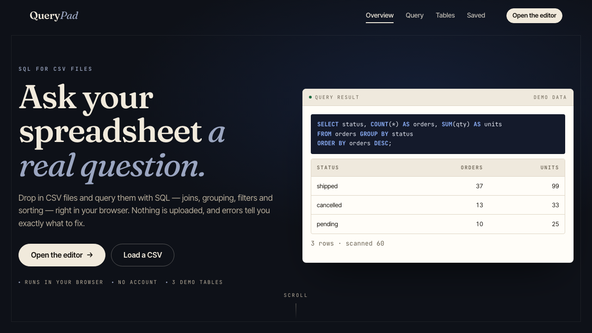
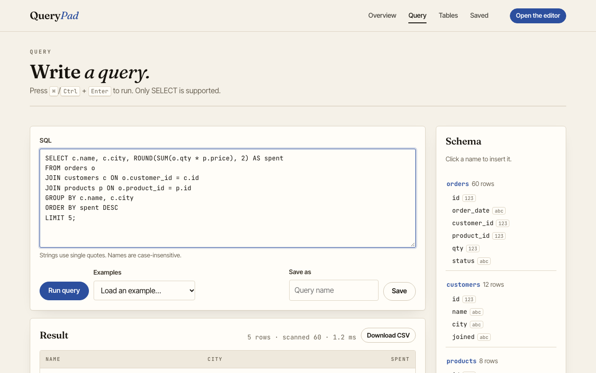
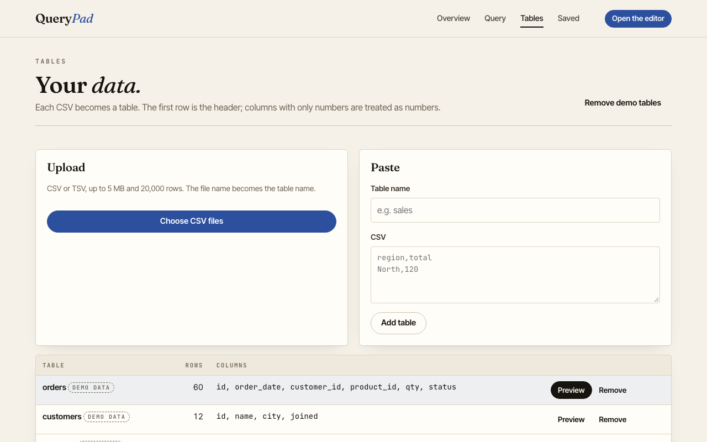
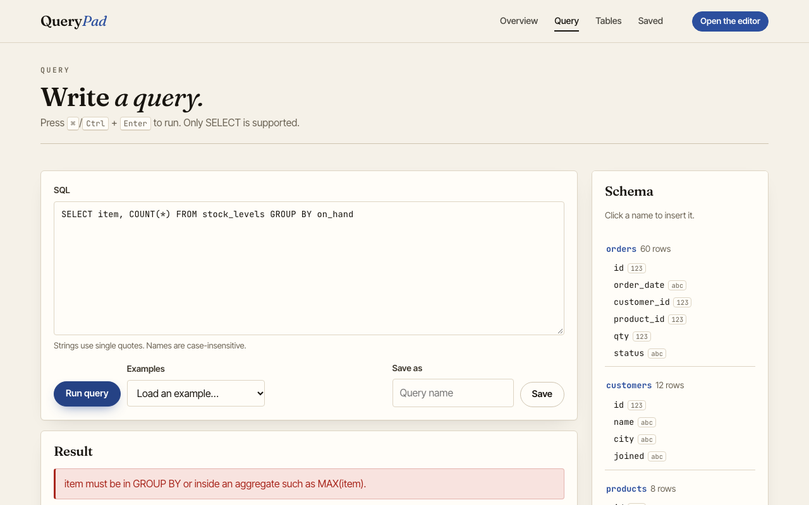

# QueryPad

Query CSV files with SQL in the browser. Load or paste CSVs, write SELECT queries with joins, grouping and filters, and export the result — nothing is uploaded, and error messages explain exactly what to fix.

**Live demo:** [https://querypad.vercel.app/](https://querypad.vercel.app/) — runs entirely in your browser.



| Editor | Tables | Errors |
| --- | --- | --- |
|  |  |  |

## Run it

```bash
npm install
npm run dev        # http://localhost:5301
npm test
npm run build
npm run test:e2e   # Playwright smoke test (npm run e2e:install once if Chromium is missing)
```

## Main workflow

1. **Tables** → upload CSV/TSV files (up to 5 MB, 20,000 rows) or paste CSV with a name. Column names are normalised (`First Name` → `first_name`); columns containing only numbers become numeric. Preview or remove any table.
2. **Query** → write SQL and press ⌘/Ctrl + Enter (or **Run query**). Click a table or column in the schema panel to insert it at the cursor; load one of five examples.
3. Results are paginated (25 rows a page) with row count, rows scanned and timing; **Download CSV** exports the full result.
4. Errors show a plain-English message and a caret under the problem position.
5. **Save as** keeps a named query; **Saved** lists saved queries and the last 20 runs, each reopenable.
6. Tables, saved queries and history persist in this browser. Demo tables (orders, customers, products — fictional) can be removed or reloaded.

## Supported SQL

- `SELECT [DISTINCT] … FROM t [AS a] [[LEFT] JOIN u [AS b] ON …]… [WHERE …] [GROUP BY …] [HAVING …] [ORDER BY … [ASC|DESC]] [LIMIT n [OFFSET m]]`
- Operators: `+ - * / %`, `||`, `= != <> < > <= >=`, `AND OR NOT`, `LIKE` (% and _, case-insensitive), `IN (…)`, `BETWEEN`, `IS [NOT] NULL`.
- Aggregates: `COUNT(*)`, `COUNT/SUM/AVG/MIN/MAX([DISTINCT] x)`. Functions: `LOWER UPPER TRIM LENGTH ROUND ABS COALESCE SUBSTR`.
- ORDER BY and HAVING can use output aliases; ORDER BY and GROUP BY accept column positions. NULLs sort last.
- Equality joins use a hash join; other join conditions are capped at 2 million row pairs.
- Read-only: INSERT, UPDATE, DELETE and DDL are refused.

## Design

Shared editorial system: Fraunces display type, Inter Tight interface text, mono SQL and results, a cobalt accent, an ink hero showing a real query result, and a warm paper workspace. NULLs are shown explicitly; numbers are right-aligned.

## Tests

- `src/lib/sql.test.ts` — CSV loading and type inference, name normalisation, tokenizing strings and comments, error positions and messages, filtering/ordering/limits, LIKE/IN/BETWEEN/functions, GROUP BY with HAVING and aliases, ungrouped-column and WHERE-aggregate errors, inner, left and chained joins, ambiguity errors, `*` expansion, DISTINCT, OFFSET, NULL ordering.
- `src/App.test.tsx` — running with ⌘+Enter, errors with caret, examples, schema insertion, saving queries, pasting and validating a table, removing a table, querying new data.
- `e2e/smoke.spec.ts` — landing, keyboard run, CSV upload with reload persistence, filtering, CSV download, an error message, plus 375px layout checks.

## Limitations

- A subset of SQL: no subqueries, window functions, UNION or CASE.
- Tables live in browser storage (about 5 MB); larger sets work for the session only.

## Future improvements

- Subqueries and CASE; charts for grouped results.

## Licence

MIT — see [LICENSE](LICENSE).
